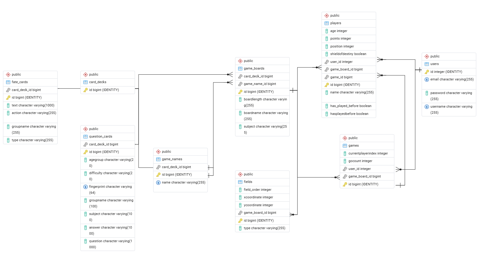

# Take a Chance
af Sussie Frantzen

Studerende på EK-Lyngby

3 semester portfolio projekt

### Vision
Take a Chance er det første af en række læringsorienteret brætspilsapplikationer.
<br>
Take a chance gør det interaktivt og tilgængeligt at lære om sandsynlighedsberegning.
<br>
Applikationen er primært rettet mod undervisningsbrug og henvender sig til spillere fra 6 år og opefter.
<br>
Spillet er designet med let humor, og let frustration så det ikke føles som en undervisnings quiz.
<br>
Den understøtter både spil for én person og multiplayer-sessioner med op til fire spillere.
<br>
Applikationen er designet, så der løbende kan tilføjes flere spil.
<br>
Den første version indeholder spillet Take a Chance,
<br>
som fokuserer på sandsynlighedsberegning og hjælper
<br>
spillerne med at udforske de matematiske begreber gennem spil.

### Links
Portfolio-hjemmeside:
https://sussiefrantzen.github.io/portfolio/


Deployet applikation:
https://take-a-chance.xn--fnixdesign-0cb.com/


Kildekode (repository):
https://github.com/SussieFrantzen/3_semester_Take_a_chance.git

### Arkitektur
#### Systemoversigt
Take a Chance er en Java-baseret applikation bygget op omkring en REST API-arkitektur.
<br>
Backenden håndterer:
* forespørgsler
* spillets logik
* dataadgang 
* kommunikationen med databasen.

Applikationen benytter en ekstern API
<br>
til at hente yderligere spørgsmål til spillets kortbunke.
<br>

Arkitekturen er designet med henblik på fremtidig udvidelse, så der kan tilføjes flere spil.

#### Arkitektur diagram:

``` plaintext
src
├── main
├──── java
│      └── app
│          ├── config
│          ├── controllers
│          ├── dao
│          ├── dtos
│          ├── entities
│          ├── route
│          ├── security
│          ├── service
│          ├── utils
│          └── Main
└── resources
```

#### Anvendte teknologier
* Java 25
* Javalin 6.5
* Maven
* JPA / Hibernate
* PostgreSQL
* pgAdmin
* HikariCP
* Jackson
* Lombok
* jBCrypt
* JUnit 6
* Testcontainers
* REST Assured
* Hamcrest


### Vigtige Designbeslutninger
Jeg startede ud med at tænke over hvordan mit system skulle bygges op ved at finde ud af
<br> 
hvilke entities der skulle være. Jeg læste mit spils regler igennem og
<br>
så på hvilke handlinger man normalt skal fortage sig.
<br>
Altså hvilke mekanismer, der ikke krævede en fysisk person til når systemmet kunne gøre det.
<br>
Men jeg skulle stadig tænker over hvad er det som brugeren skulle intergere med og kunne give af indput.
<br>
Den del har jeg formulleret en masse om i mine UserStories der ligger på min portefolie side (se link).
<br>
Jeg fandt demed fremtil at der lå en masse forretningsforståelse og dermed skulle der være service
<br>
lag der kunne forbinde en masse af denne logik. Jeg er bevidst om
<br>
jeg mangler noget af det endnu, men det ikke ligefrem
et simpelt spil.
<br>
Men for at vende tilbage til designbeslutningerne, havde lært om REST og JPA.
<br>
Derfor gav det mening at anvende den form for arkitektur, da arbejdsfordelingen mellem klasserne blev uddelt.
<br>
Hvilket giver meget god mening når der er flere elementer i spil og som skal tale med database og føre en handling.
<br>
Jeg endte også ud med at anvende synchronized som betyder
<br>at kun en tråd af gangen kan udføre en bestemt del af koden på et objekt.<br>
Dette gav mening i forhold til nogle af de ting der sker i mit spils logik. <br> Da der nogle handlinger der skal ske først før næste handling må ske.


Eksempler på noget af logikken der skal tages højde for:
* En bruger har en acount. Brugeren kan vælge at spille alene eller med flere. <br>
Dette resultere i at vi skal have et userobjekt, game objekt og player objekt der skal forbindes.
<br>
Dette betyder også at vi skal kunne opsamle info på flere personer til det enkelte spil. 
<br>
Men det ikke alle der må have adgang til spillet.

Dermed skal systemmet tjekke både om brugeren er logget på, <br>
samt hvilket id, så handlingerne sker på det rigtige spil. <br>
Spillerenes data skal også kunne gemmes uden det ødelægger andres brugeres spil.
<br> Det må derfor ikke overrite det oprindelige i databasen.


* Hvems tur er det, hvad sker der når dette kort er trukket.
<br>Hvordan skal spilleren svare på spørgsmål eller handling.
<br>
må spilleren rykke frem eller skal de blive stående.


Selv fra start er der spil logik der skal sættes op og tænkes over,
<br> fejlhåndtering hvis man taster for mange eller ingen ind. Oprettelse af spilinstans.


Jeg har valgt at mit system tjekker brugeren og kan kun arbejde videre
<br>på en player hvis der er en gyldig bruger.

Mit system bruger en del exeptions og try catch til at håndtere flere af fejlene.
<br>Der er også lavet en håndtering på
entitiene så der ikke kan komme flere af samme email ind i databasen.
<br>Jeg har gjort så der ikke kommer 
dubletter af de genererede spørgsmålskort.

Jeg forstiller mig når koden bliver udviklet mere på vil der komme flere fejlhåndteringer
<br> og når frontEnd kommer på skal der jo især være synlige beskeder til brugeren.

Systemet er bygget op med Hibernate, som bruges til at håndtere kommunikationen
<br> med databasen gennem Java-objekter i stedet for at skrive SQL-forespørgsler manuelt.

### Datamodel

#### ER-Diagram




Som det kan ses på ERD er der en del entities som alle er forbundet.

Entities:
* Game
* gameboard
* field
* User
* CardDeck
* Questencard
* GameNAme
* FateCard
* Player


### Vigtige Entities
Der jo ikke en entities der ikke er vigtig.

Useren er vigtig for vi kan lade flere personer bruge samme spil<br>
da vi kobler deres id med et game-objekt og player-objekt.

Gameboard holder på Carddeck, et navn, en spillerliste og på liste af Field.

Field har koordinater og en type 

Carddeck holder på en liste af QuestenCard og FateCard samt Carddeck har et id så <br>
kortene tilhøre bestemte kortbunker i forhold til spillet.


### API-dokumentation
se under resources markdown


## User stories
### vigtigste for projektet:
Det er svært at sortere user stories fra da de alle har en relevans for spillet.

#### US9 – Angiv spillerens niveau/alder
Som game-master vil jeg kunne angive hver spillers alder eller faglige niveau,
<br>
så spillet kan tilpasses den enkelte spiller.

##### Acceptkriterier:
•	Game-master kan angive alder eller niveau for hver spiller.
<br>
•	Oplysningerne gemmes sammen med spilleren.
<br>
•	Niveauet bruges til at tilpasse relevante spørgsmål/kort.


#### US7 – Se spillebrikker
Som spiller vil jeg kunne se min egen og de andre spilleres placeringer på spillepladen,
<br>
så jeg kan følge spillets udvikling.

##### Acceptkriterier:
•	Hele den relevante spilleplade vises.
<br>
•	Alle aktive spilleres brikker vises.
<br>
•	Det er muligt at identificere, hvilken brik der tilhører hvilken spiller.
<br>
•	Brikkernes placering opdateres efter en spillers tur.


#### US4 – Udfør sin tur
Som spiller vil jeg kunne se, når det er min tur,
<br>
og hvilke handlinger jeg kan foretage, så jeg ved, hvad jeg skal gøre.

##### Acceptkriterier:
•	Den aktive spiller fremhæves tydeligt.
<br>
•	Spilleren kan se sine tilgængelige handlinger.
<br>
•	Terning/spinner eller andre relevante spilleelementer kan aktiveres, når det er spillerens tur.
<br>
•	Andre spillere kan se, hvem der har tur.


####  US12 – Kast terning
Som spiller vil jeg kunne aktivere en terning,
<br>
så systemet kan generere et tilfældigt antal øjne.

##### Acceptkriterier:
•	Spilleren kan aktivere terningen, når den er relevant.
<br>
•	Terningen viser en animation.
<br>
•	Systemet genererer et tilfældigt resultat.
<br>
•	Resultatet vises tydeligt.

#### US14 – Flyt spillerbrik
Som spiller vil jeg kunne se min brik flytte sig efter mit terning-/spinnerresultat,
<br>
så jeg tydeligt kan se resultatet af min tur.

##### Acceptkriterier:
•	Spillerens resultat bestemmer, om og hvor langt brikken flyttes.
<br>
•	Brikken animeres eller flyttes synligt på spillepladen.
<br>
•	Spillerens point/status opdateres efter bevægelsen.
<br>
•	Hvis spilleren mister sin tur, bliver brikken stående.
<br>
•	Systemet viser tydeligt, hvis spilleren mister sin tur.

#### US8 – Træk tilfældigt kort
Som spiller vil jeg automatisk få tildelt et tilfældigt kort, 
<br>
når jeg lander på et felt, der udløser et kort, så spillet kan 
<br>
fortsætte med en tilfældig udfordring eller handling.

##### Acceptkriterier:
•	Systemet registrerer, når en spiller lander på et kortfelt.
<br>
•	Systemet vælger et tilfældigt kort fra den relevante kortbunke.
<br>
•	Det valgte kort vises for spilleren.
<br>
•	Korttypen afhænger af feltet og spillets indstillinger.


#### US18 – Tilpas kort efter niveau
Som spiller vil jeg få spørgsmålskort, der passer til mit valgte niveau
<br>
eller min alder, så spillets faglige udfordringer passer til mig.

##### Acceptkriterier:
•	Spillerens alder/niveau er registreret.
<br>
•	Når spilleren lander på et kortfelt, identificerer systemet spillerens niveau.
<br>
•	Systemet vælger kun relevante kort eller tilpasser sværhedsgraden.
<br>
•	Det valgte kort vises derefter for spilleren.


### Udvidelsesmuligheder
Take a Chance er designet til at kunne udvides med flere spil over tid.
<br>
Den første version fokuserer på sandsynlighedsberegning med vægt på
<br>
alderssvarende læring og anvendelse i undervisningen.
<br>
Opdelingen i routes, controllers, services og dataadgangskomponenterne
<br>
skaber et fundament for at udvide funktionaliteten.